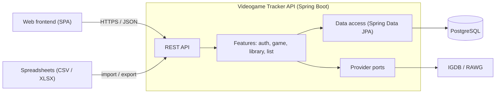
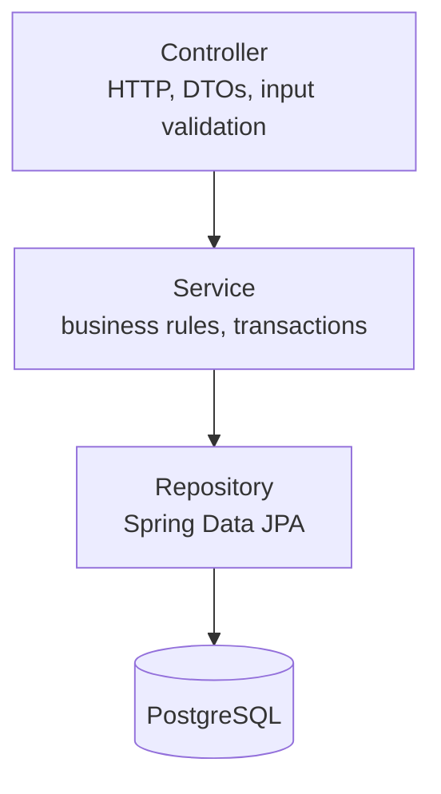
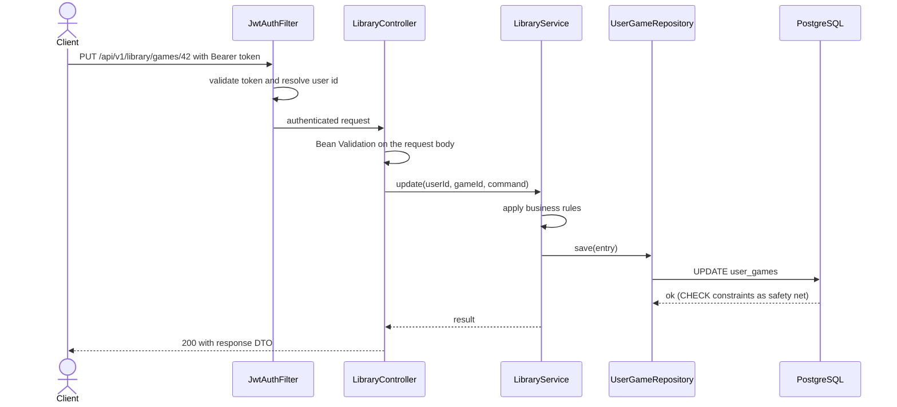

# System Overview

**Project Name:**  videogame-tracker

**Last Released Version:**  none

**Version in development:**  0.0.1

**Description:**  Videogame Tracker - Personal video game catalog and library management

**Main Technologies:** Spring, Docker, PostgreSQL

---
## 📑 Summary

- [01 Architecture](#01-architecture)
- [02 Development_Conventions](#02-development_conventions)
- [03 Folder Structure](#03-folder-structure)
- [04 Enviroment](#04-enviroment)
- [05 Devops](#05-devops)
- [06 Tasks_And_Notes](#06-tasks_and_notes)


---
<a id="01-architecture"></a>
<details>
  <summary>📌 01 Architecture</summary>

# Architecture

## Description

> Living document. It describes the target architecture; implementation is incremental and each major choice is recorded as an ADR in `docs/02-adr/`.

### Overview

Videogame Tracker is a **modular monolith**: a single Spring Boot REST API, backed by PostgreSQL, organized **by feature** (package-by-feature) with a classic **layered structure inside each feature**. Clients (a web frontend, spreadsheet import/export, future integrations) only talk to the API.



### Architectural style and why

| Decision | Choice | Rationale |
| --- | --- | --- |
| Deployment unit | Modular monolith | One developer, one database, strong consistency needs. Microservices would add operational cost with no benefit at this scale. |
| Code organization | Package-by-feature, layered inside | Everything about "library" lives together; features are easy to find, test and, if ever needed, extract. |
| Layers | Controller → Service → Repository | Simple, well-known, and enough. Full hexagonal/DDD would be over-engineering for a CRUD-centric domain. |
| External systems | Ports and adapters **only** for third-party providers | The one place where swapping implementations is realistic (IGDB, RAWG, Google Sheets), so it is the one place that gets an interface. |
| API style | Stateless REST + JSON, OpenAPI contract | Lets the frontend and spreadsheet tooling be built against a stable contract. |
| Persistence | PostgreSQL + Spring Data JPA, schema owned by Flyway | The database is the last line of defense for data integrity; Hibernate never changes the schema. |

### Package structure

```en
com.yourname.videogametracker
├─ auth/         registration, login, JWT issuing and validation
├─ user/         user account data
├─ game/         shared catalog: games, publishers, platforms, genres, franchises
├─ library/      personal library (user_games): status, rating, playtime, purchases, stats
├─ list/         custom lists and ordering (lists, list_games)
├─ integration/  provider ports and adapters (IGDB/RAWG), CSV/XLSX import and export
└─ shared/       error handling, configuration, common utilities
```

Inside each feature:

```en
library/
├─ LibraryController.java      HTTP only: routing, validation, status codes
├─ LibraryService.java         business rules and transactions
├─ UserGameRepository.java     Spring Data JPA
├─ UserGame.java               JPA entity (never exposed by the API)
└─ dto/                        request and response records
```

### Layers and dependency rules



- **Controllers are thin.** They translate HTTP to a service call and back. No business logic, no repositories.
- **Services own the rules and the transaction boundary** (`@Transactional`), for example "`finished_at` is only set when the status is `completed`".
- **Entities never leave the service layer.** The API speaks in DTOs (Java records), so the database model can evolve without breaking the contract.
- **Features talk through services, not repositories.** `library` may call `GameService`; it may not touch `GameRepository`.
- These rules are enforced by **ArchUnit** tests, so they fail the build instead of living only in documentation.

### Request lifecycle

Example: updating a game in the personal library.



### Data layer

- **Flyway migrations** (`V1__create_initial_schema.sql`, ...) are the single source of truth for the schema. Hibernate runs with `ddl-auto=validate`; applied migrations are never edited.
- **Defense in depth:** business rules live in the service layer **and** as database constraints (`CHECK`, composite foreign keys, unique indexes), so invalid data is rejected even if one layer has a bug.
- **Integrity choices:** a user's data cascades on user deletion, while shared catalog rows referenced by someone's library cannot be deleted (`RESTRICT`).
- **Performance hygiene:** `spring.jpa.open-in-view=false`, explicit fetch strategies (`@EntityGraph` / fetch joins) to avoid N+1 queries, pagination on every list endpoint, and indexes designed for the real queries (for example `(user_id, status)` for the dashboard).
- **Timestamps** are `timestamptz` stored in UTC; `updated_at` is maintained by a database trigger.
- **Identity:** `GENERATED BY DEFAULT AS IDENTITY` keys, case-insensitive uniqueness for username and email.

### Security

- **Stateless authentication** with JWT; passwords stored as BCrypt (or Argon2) hashes, never in plaintext.
- **Ownership rule:** every query on user-owned data (`user_games`, `lists`) is scoped by the **authenticated user id taken from the token**, never from a client-supplied parameter. Integration tests assert that one user cannot read or change another user's data.
- **Roles:** `user` and `admin`. The shared catalog is writable only by `admin`.
- **Secrets and configuration** come from environment variables (12-factor); nothing sensitive is committed. Profiles: `dev`, `test`, `prod`.

### API design

- Versioned base path: `/api/v1/...`.
- Pagination, sorting and filtering (title, type, franchise, status) on listings, with Spring Data Specifications for composable filters.
- A single global exception handler (`@RestControllerAdvice`) returns **Problem Details (RFC 9457)** for every error, with a consistent shape for validation, not-found and conflict cases.
- The OpenAPI document (springdoc) is the contract for the frontend and any generated clients.

### External integrations

Third-party providers are isolated behind a port, so the domain never depends on a vendor SDK or payload format:

```java
public interface GameMetadataProvider {
    Optional<GameMetadata> findByExternalId(String externalId);
    List<GameMetadata> search(String query);
}
```

- `IgdbGameMetadataProvider` (and a possible `RawgGameMetadataProvider`) implement it.
- Imports are **idempotent**: `games.external_source` + `games.external_id` are unique, so re-importing never duplicates a game.
- Outbound calls use explicit timeouts, retries with backoff, and caching to respect rate limits and survive provider outages.
- **CSV/XLSX import and export** live in the same module and go through the same services and validations as the REST API. A Google Sheets adapter can follow the same pattern.

### Cross-cutting concerns

- **Validation:** Bean Validation on DTOs, domain rules in services, constraints in the database.
- **Observability:** structured logs with a correlation id per request, and Spring Boot Actuator for `/actuator/health`.
- **Configuration:** typed `@ConfigurationProperties` classes instead of scattered `@Value` annotations.

### Testing strategy

| Level | Scope | Tools |
| --- | --- | --- |
| Unit | Business rules in services and mappers, without Spring | JUnit 5, Mockito, AssertJ |
| Slice | Controllers and repositories in isolation | `@WebMvcTest`, `@DataJpaTest` |
| Integration | Full stack against a **real PostgreSQL** with migrations applied | Testcontainers |
| Security | Authentication, roles and cross-user access | Spring Security Test |
| Architecture | Layering and feature-boundary rules | ArchUnit |

Most tests are fast unit tests; a smaller number of integration tests cover the critical flows. Coverage is reported with JaCoCo.

### Build, CI/CD and deployment

- **Monorepo** with `apps/` (API, web), `infra/` (Docker Compose, database init scripts) and `docs/` (README sources, ADRs, database model).
- **CI** (GitHub Actions) runs build and tests on every push, using path filters so API changes do not trigger unrelated jobs.
- **Docker:** a multi-stage `Dockerfile` produces a small runtime image; `infra/compose.yaml` runs PostgreSQL locally.
- **Environments:** local development uses Docker Compose; production uses a managed PostgreSQL (free-tier friendly) and a container host, configured only through environment variables.
- Conventional Commits and SemVer tags (`v0.1.0`, ...) keep the history readable.

### Evolution path

The design deliberately stays simple, but leaves clear seams for growth:

- **Per-platform ownership:** a `user_game_copies` table if the same game must be tracked on several platforms or stores.
- **Module extraction:** features already communicate through services, so a heavy one (for example imports) could become a separate process later.
- **Async work:** move large imports to a background job queue if they outgrow a request/response cycle.
- **Caching:** add a cache for catalog reads if traffic ever justifies it.

### Decision records

Key decisions are documented as ADRs in `docs/adr/`, including: modular monolith over microservices, Flyway-owned schema, stateless JWT authentication, separation of play status and purchase intent, ports only for external providers, and the choice of hosting.

</details>

---
<a id="02-development_conventions"></a>
<details>
  <summary>📌 02 Development_Conventions</summary>

# System Development Practices

## Security

- Use of `Environment Variables`, which should be added to `.gitignore`
- Store `sensitive variables` (passwords and tokens) in `Current Value` in `Postman`

## Development Conventions

## Commits

- Follow Conventional Commits
  - `<type>(<optional scope>): <short description>`
  - Preferably in `English` and in `third person singular` (it does), for standardization
  - <https://www.conventionalcommits.org/en/v1.0.0/#summary>

- Examples:
  - feat(auth): adds login OAuth
  - fix(api): corrects validation bug
  - docs: updates doc file x

## Standards

### Language

Repository and code: English

</details>

---
<a id="03-folder-structure"></a>
<details>
  <summary>📌 03 Folder Structure</summary>

# Folder Structure

## Repository Root

```bash
Project-Root/
├─ src(apps)/ # Repository Applications
├─ docs/ # Repository Documentation
├─ infra/ # Configuration files, environment setup, and support scripts
├─ .github/workflows/ # CI/CD Scripts
├─ .gitignore # Files to be ignored in all commits
├─ README.md # Comprehensive documentation generated from /docs files
```

## Apps

```bash
apps/(app-name)
├── src/ # Main Source Code
```

</details>

---
<a id="04-enviroment"></a>
<details>
  <summary>📌 04 Enviroment</summary>

# Infra and Development Enviroment

## Development Environment

**Description:** how to run the project and add new features.

### Requirements

- Spring/Java
- Postgres
- Git
- Docker

#### Setup

1. Clone the repository.
2. Run enviroment on docker.
3. Configure environment variables.
4. Start required services.
5. Run the application.

#### Development Workflow

Create issue
     ↓
Create feature branch
     ↓
Develop
     ↓
Run tests
     ↓
Commit
     ↓
Pull Request
     ↓
Code Review
     ↓
Merge

## Infrastructure

**Description:** where the application runs.

### Hosting

| Service | Provider | Purpose |
| --- | --- | --- |
| Database | Neon | Database cloude hosting |
| Static website | GitHub Pages | Frontend hosting |

### Database

| Service | Technology | Purpose |
| ---------------- | --------------------- | ------------------------- |
| Main Database | PostgreSQL | Application |
| — | — | — |

### External Services

| Service | Purpose |
| --- | --- |
| JWT/Oauth2.0 | Authentication |
| RabbitMQ | Message broker |

</details>

---
<a id="05-devops"></a>
<details>
  <summary>📌 05 Devops</summary>

# DevOps Pipeline

Documentation of the project's DevOps processes, including CI/CD pipelines, automation, deployment, infrastructure, and monitoring.

---

## 📑 Contents

- [CI — Continuous Integration](#ci--continuous-integration)
- [CD — Continuous Delivery - Deployment](#cd--continuous-delivery---deployment)
- [Automation](#automation)
- [Infrastructure](#infrastructure)

---

## CI — Continuous Integration

**Description:** Processes executed when code is integrated or updated in the repository, such as commits and pull requests.

## CD — Continuous Delivery - Deployment

**Description:** Processes responsible for building and deploying the application.

### Deploy

**File:** `deploy.yml`

**Purpose:** Builds the application and deploys it to the target environment.

**Trigger:**

- Push to main or master

**Process:**

```text
Push to main/master*
      ↓
Install dependencies
      ↓
Build
      ↓
Upload artifact
      ↓
Deploy
```

## Automation

**Description:** Automated processes that support development and project maintenance but are not necessarily part of CI/CD.

### Available Automations

| Automation       | File                  | Description               |
| ---------------- | --------------------- | ------------------------- |
| README Generator | `generate_readme.yml` | Generates the main README |
| —                | —                     | —                         |

## Infrastructure

### Docker

**Purpose:** Builds the application enviroment in a container.

</details>

---
<a id="06-tasks_and_notes"></a>
<details>
  <summary>📌 06 Tasks_And_Notes</summary>

# Tasks and Notes

## Tasks

**Description:** Tasks, activities, and features that need to be implemented or completed.

**Format:** `[date - author name - description]`. Ordered by date in descending order.

## Contents

- [ ] 10/02/2025 - Thiago Costa - Initial example task

---

## Notes

**Description:** Useful notes and information for documentation, such as architectural decisions and opinions.

**Format:** `[date - author name - description]`. Ordered by date in descending order.

## Contents

- 10/02/2025 - Thiago Costa - Initial example note

</details>
